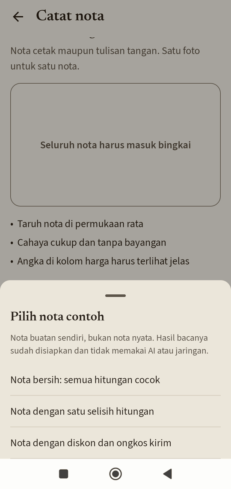
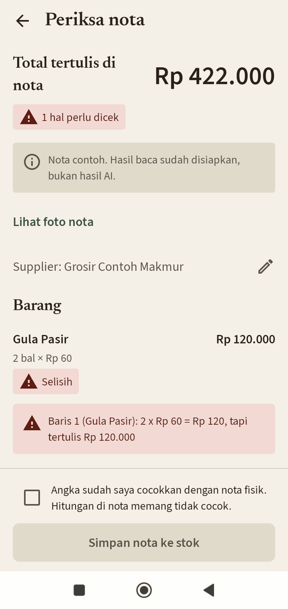
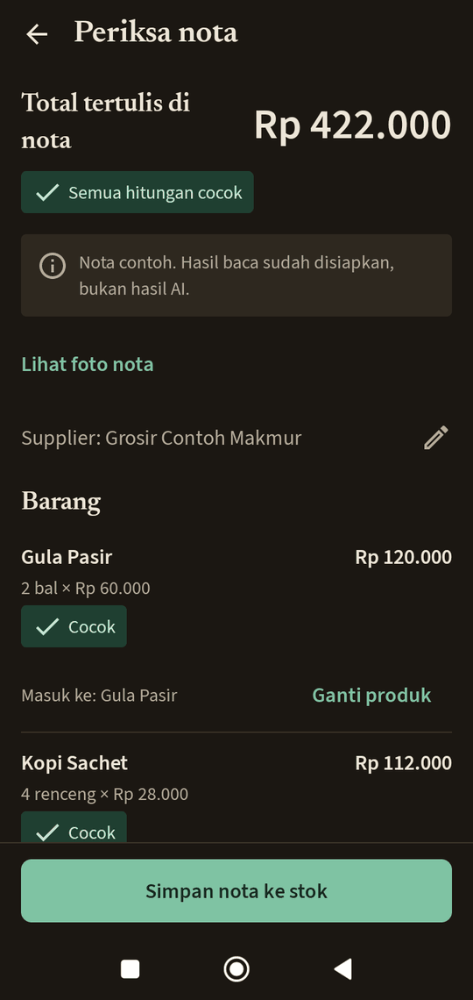
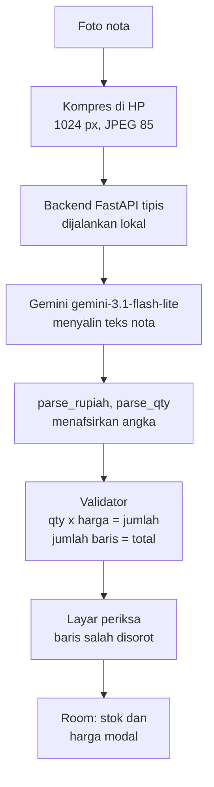

# Nota Kulakan

Nota kulakan dari grosir dicatat tangan di buku; stok tidak dihitung dari nota dan kenaikan harga modal tidak
terlihat. Aplikasi ini membaca foto nota dengan AI, memeriksa hitungannya dengan aturan, lalu mencatat stok dan
harga modal.

- Demo video: [video demo: menyusul]
- Unduh APK: [APK: menyusul di Releases]
- Tangkapan layar: di bawah.

Proyek ini adalah studi kasus produk dan rekayasa, bukan pesaing aplikasi kasir atau pencatat stok yang sudah mapan.

<p>
  
  
  
</p>

Tangkapan layar dari mode contoh (data sintetis).

## Status

- Lapisan 1 (foto nota, ekstraksi, periksa dan koreksi, simpan ke stok, riwayat dan stok) sudah ada di
  aplikasi, dan evaluasi set uji sudah dijalankan (lihat Hasil evaluasi). Pengukuran waktu lapangan belum dilakukan.
  Lapisan 2 dan seterusnya belum dikerjakan.
- APK di Releases berjalan dalam **mode contoh**: nota sintetis berlabel "contoh" diproses tanpa server dan
  tanpa kunci. Tombol foto dan galeri nonaktif karena APK tidak terhubung ke backend publik
  ([KEPUTUSAN 20](docs/KEPUTUSAN.md)).
- Kemampuan AI yang asli ditunjukkan lewat video demo dan angka evaluasi di bawah. Untuk mencoba AI asli,
  jalankan backend sendiri dengan kunci Gemini sendiri (lihat Menjalankan).
- Backend dijalankan lokal. Deploy ke Cloud Run belum dilakukan.

## Masalah dan cara lama

Toko sembako menerima nota kulakan (cetak dan tulisan tangan) dari grosir dan sales. Di toko yang menjadi studi
kasus, nota dicatat tangan di buku dan kertasnya disimpan di laci. Stok dan harga modal tidak dihitung dari
nota, sehingga kenaikan harga modal tidak terlihat.

**Hipotesis (belum diukur):** mencatat nota lewat aplikasi lebih cepat per nota daripada menulis di buku, dan
hasilnya lebih jarang salah karena hitungan diperiksa otomatis. Cara uji: 10 nota (target; minimal 6), tiap nota
dikerjakan dua kali oleh satu orang, cara lama dan aplikasi, urutan diselang-seling, waktu dengan stopwatch.
Protokol lengkap dan keterbatasannya: [`docs/EVALUASI.md` bagian 13](docs/EVALUASI.md). Belum ada angka waktu.

## Cara kerja



Kunci API hanya ada di backend; APK tidak membawa kunci. Prinsip: **model menyalin, kode menafsirkan dan
memeriksa.** Alasan tiap keputusan ada di [`docs/KEPUTUSAN.md`](docs/KEPUTUSAN.md).

## Hasil evaluasi

Definisi dan prosedur: [`docs/EVALUASI.md`](docs/EVALUASI.md). Ringkasan lengkap:
[`docs/hasil/uji-2026-10-20-putaran2.md`](docs/hasil/uji-2026-10-20-putaran2.md).

**Nota sempurna** = tidak gagal, jumlah baris sama dengan kunci, dan setiap baris cocok persis di qty, harga
satuan, diskon baris, dan jumlah, serta diskon, pajak, biaya lain, pembulatan, dan total nota sama persis dengan
kunci (nama barang tidak dinilai).

**Angka utama:** `gemini-3.1-flash-lite` pada foto 1024 px, prompt v2, set uji 12 nota cetak milik sendiri:
**5/12 nota sempurna (42%, Wilson 95% 19-68%)**. Interval lebar karena n kecil.

Putaran 2 (2026-10-20, satu-satunya putaran resmi; prompt v2; foto ditutup kotak hitam). Biaya = perkiraan
harga daftar (tier gratis, tanpa tagihan), harga dibaca 2026-10-20.

| Konfigurasi | Nota sempurna (Wilson 95%) | Total benar | Diskon baris | Validator menangkap | Biaya/nota | Latensi p50/p90 | Foto |
|---|---|---|---|---|---|---|---|
| 3.1-flash-lite @1024 | 5/12 = 42% (19-68%) | 92% | 78% | 4/4 | $0,00113 | 2,6 / 16,5 s | 88 KB |
| 3.1-flash-lite @1600 | 6/12 = 50% (25-75%) | 83% | 88% | 3/3 | $0,00115 | 2,6 / 25,4 s | 193 KB |
| 3.5-flash-lite @1024 | 7/12 = 58% (32-81%) | 92% | 90% | 2/2 | $0,00170 | 2,1 / 4,1 s | 88 KB |
| 3.5-flash-lite @1600 | 7/12 = 58% (32-81%) | 100% | 90% | 2/2 | $0,00170 | 2,1 / 2,6 s | 193 KB |

Gagal (waktu habis, layanan) 0 di keempat konfigurasi; alarm palsu validator 0 di semuanya. Selisih antar
konfigurasi sampai 2 nota dari 12 tidak bermakna secara statistik; interval saling tumpang tindih.

**Aturan pemilihan, ditetapkan sebelum uji dijalankan** (EVALUASI bagian 9): pindah model hanya bila unggul
>= 2 nota sempurna dan biaya per nota <= 3x; foto 1024 px dipakai bila nota sempurnanya tidak lebih rendah dari
1600 px lebih dari 1 nota. Hitungannya: 3.5-flash-lite unggul 1 nota (7 vs 6), jadi model tetap
`gemini-3.1-flash-lite`; 1024 px (5/12) tidak lebih rendah dari 1600 px (6/12) lebih dari 1 nota, jadi 1024 px.
Ini hasil penerapan aturan, bukan klaim bahwa 1024 px lebih akurat.

**`gemini-3.8-flash` tidak selesai dievaluasi.** Pada @1600 px 9 dari 12 nota gagal waktu habis (batas 30 detik
per panggilan), lalu kuota harian tier gratis (20 permintaan per hari per model) habis (429); @1024 px tidak
dijalankan. Tidak ada klaim lebih baik atau lebih buruk tentang akurasinya.

**Validator.** Pada 9 nota yang kuncinya konsisten secara aritmetika, semua nota yang salah ditandai validator
di keempat konfigurasi (terlewat 0 dari 2-4). Pembaginya kecil (n kecil); ini belum cukup untuk kesimpulan lebih jauh.
Tiga nota uji (023, 024, 027) kuncinya sendiri tidak konsisten dan dilaporkan terpisah.

**Pola salah yang tercatat:** diskon persen per baris (009, 018) tidak terbaca; total tulisan tangan terpakai
sebagai total (022, pada 3.1-flash-lite); PPN yang sudah termasuk terbaca sebagai pajak tambahan (027, pada
3.5); satu hasil rusak total pada 024 @1600 (dugaan foto terbalik, belum diselidiki). Nota 009, 018, 023, 024,
dan 027 salah di keempat konfigurasi.

### Set internet dan uji ketahanan (terpisah dari set uji)

Konfigurasi sementara `gemini-3.1-flash-lite` @1024 px, dijalankan sekali, tidak dipakai menyetel apa pun.

- **Set internet** (5 foto dari internet; 2 tulis tangan, 2 campuran, 1 cetak): 5/5 nota sempurna (Wilson 95%
  57-100%). Ini **bukan akurasi umum**: n=5, distribusinya berbeda dari set uji (struk ritel kecil, sedikit baris
  diskon), dan tidak boleh dibandingkan langsung dengan 42%. Penyebab selisihnya belum diselidiki. Foto adalah
  milik pemilik aslinya (hak cipta), tidak didistribusikan; hanya angka agregat yang dilaporkan.
- **Uji ketahanan** (5 kasus, kualitatif, "nota sempurna" tidak dihitung):
  - 006, kertas terpotong: qty diisi walau kunci null, tanpa tanda ragu; validator menandai 1 baris.
  - 007, dua nota dalam satu foto: digabung jadi satu nota tanpa peringatan; validator menandai 3 baris dan 1 kosong.
  - 011, retur: tidak ada sinyal retur; validator menandai baris 4.
  - 016, salinan 014: hasil sama dengan 014; validator lolos, jadi akan masuk otomatis.
  - 026, salinan 025 plus baris bonus tanpa harga: 7 baris identik dengan 025; validator menandai baris tanpa harga.

  Pada foto yang tidak lengkap atau berisi dua nota, model tidak memberi tanda ragu; penjaganya hanya validator
  dan konfirmasi pengguna.

## Biaya, latensi, data

Dari tabel putaran 2, konfigurasi terpilih (3.1-flash-lite @1024): sekitar $0,00113 per nota (perkiraan harga
daftar, token berpikir dihitung sebagai token keluaran; tier gratis tidak ditagih), latensi p50 2,6 detik dan
p90 16,5 detik pada mesin evaluasi (bukan HP; satu putaran, beban server tidak terkontrol), foto 88 KB. p90
mendekati batas 30 detik per panggilan. Harga dibaca 2026-10-20 dari
[ai.google.dev/gemini-api/docs/pricing](https://ai.google.dev/gemini-api/docs/pricing). Harga
`gemini-3.8-flash` naik pada 2027-01-01 (dari $0,75 masuk / $3,75 keluar menjadi $1,50 / $7,50 per 1 juta
token), jadi angka biaya model itu hanya berlaku sampai 2026-12-31.

## Keamanan dan privasi

- Tidak ada kunci API di APK atau di repo.
- App Check Play Integrity tidak berlaku untuk APK yang dipasang di luar Play, sehingga backend publik tidak
  disediakan (KEPUTUSAN 9, 17, 20).
- Gemini yang dipakai adalah tier gratis: Google boleh memakai isi permintaan untuk memperbaiki produknya.
  Karena itu foto evaluasi ditutup kotak hitam (nama, alamat, HP, NPWP, rekening pembeli) sebelum dikirim, dan
  rilis ke pengguna lain membutuhkan tier berbayar (KEPUTUSAN 16).
- Foto nota asli tidak ada di repo (`data/private/` di-ignore). Kode backend tidak menulis foto ke disk dan log
  aplikasi hanya berisi angka (token, latensi, jumlah baris), bukan isi nota. Batasnya: unggahan di atas 1 MB
  sementara ditampung Starlette di berkas sementara selama permintaan berjalan, dan foto tetap dikirim ke Gemini.

## Batas yang diketahui

- Lolos validator berarti angka konsisten satu sama lain, bukan berarti benar. Dua angka salah bisa saling
  menutupi, dan nama barang yang salah baca tidak tertangkap. Nama barang tidak dinilai dalam evaluasi.
- Diskon persen per baris dan PPN yang sudah termasuk harga belum ditangani dengan benar (lihat pola salah di atas).
  Qty dua kolom (besar + kecil) belum ditangani.
- Tulisan tangan hanya ada di set internet (n=2); nota tulisan tangan dari toko sendiri belum dievaluasi.
  Hipotesis bahwa tulisan tangan terbaca belum diuji.
- Satu toko dan satu pengguna. Set uji berasal dari satu toko, dan set dev dan uji berbagi template pemasok,
  jadi angka uji tidak sepenuhnya independen dari dev.
- Foto evaluasi tidak diambil lewat aplikasi; kompresinya ditiru dengan parameter yang sama.
- Putaran pralabel pertama untuk nota 008-027 mengirim file asli yang belum ditutup kotak hitam ke Gemini
  (termasuk EXIF); yang sudah terkirim tidak bisa ditarik kembali.
- Setelah "Hapus data contoh", produk dan alias yang dibuat dari nota contoh tetap ada di daftar pemilih produk
  (KEPUTUSAN 20, batasan 3).
- Chip status (cocok / selisih) pada kartu Riwayat dan Stok belum ada: kolom `dikonfirmasi` belum tersimpan
  (ditolak sementara, `docs/DESIGN.md`).
- Stok = total barang masuk. Penjualan belum dicatat.
- CORD berisi struk toko dan restoran, bukan nota grosir, dan tidak menguji singkatan grosir atau tulisan tangan.
- Waktu habis tidak bisa dibedakan antara model lambat dan server padat.

## Pengungkapan bantuan AI

Proyek ini dibangun dengan bantuan Claude (sebagai mentor, dalam sesi percakapan) dan Claude Code (sebagai agen
di laptop). Kode dan tes banyak ditulis dengan bantuan Claude; tes ditinjau Dani. Dani merancang evaluasi dan
tes, melabeli kunci jawaban, dan memutuskan arah produk.

## Menjalankan

```bash
# Backend: pasang, tes, dan jalankan tanpa API key (klien tiruan)
cd backend
pip install -r requirements-dev.txt && pip install -e . --no-deps
python -m pytest -q
NOTA_KLIEN=tiruan APP_CHECK=off uvicorn nota.api:app --port 8080

# Android (dari akar repo); emulator memanggil http://10.0.2.2:8080/
./gradlew assembleDebug testDebugUnitTest lintDebug

# Evaluasi
cd backend && python -m nota_eval --help
```

Hasil tes terakhir (2026-10-20): backend `pytest` 104 lulus; Android `testDebugUnitTest` 63 tes, 0 gagal,
0 dilewati (dihitung dari laporan JUnit di `app/build/test-results`). Untuk AI asli, jalankan backend tanpa
`NOTA_KLIEN=tiruan` dengan kunci Gemini sendiri; langkah operasional ada di [`docs/RUNBOOK.md`](docs/RUNBOOK.md)
dan rilis APK di [`docs/RILIS-APK.md`](docs/RILIS-APK.md).

## Struktur repo

- `backend/src/nota` (API, ekstraksi, validator), `backend/src/nota_eval` (harness evaluasi)
- `app/` (Android: domain, data, ui)
- `shared/test-vectors.json` (kontrak aturan hitungan Python dan Kotlin)
- `docs/` (PRD, TASKS, KEPUTUSAN, EVALUASI, DESIGN, RUNBOOK, rilis, hasil evaluasi)
- `licenses/` (lisensi font)

## Karya terkait

Repo receipt-parsing berbasis CORD dengan validasi aritmetika sudah ada (contoh:
[Palakshchat15/doc-ai-receipts](https://github.com/Palakshchat15/doc-ai-receipts)). Proyek ini berbeda di set
evaluasi nota grosir (cetak dan tulis tangan), alur pencatatan stok di HP, dan pengukuran biaya per konfigurasi.

## Atribusi data

CORD v2: Park et al., "CORD: A Consolidated Receipt Dataset for Post-OCR Parsing", Document Intelligence
Workshop @ NeurIPS 2019, NAVER Clova AI, lisensi CC BY 4.0
([github.com/clovaai/cord](https://github.com/clovaai/cord)).

## Lisensi

- Kode: MIT ([`LICENSE`](LICENSE)).
- Font Source Serif 4 dan Source Sans 3: SIL Open Font License ([`licenses/`](licenses/)).
- Data CORD: CC BY 4.0.
