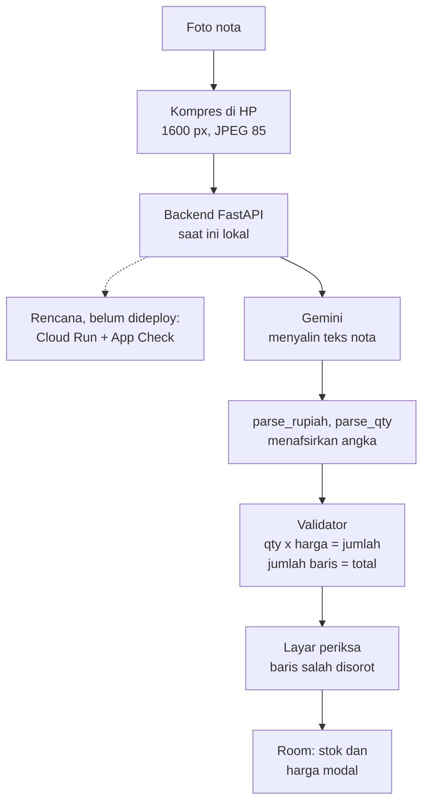

# Nota Kulakan

Foto nota dari grosir, barang masuk dan harga modal tercatat, dan hitungannya diperiksa otomatis.
Aplikasi Android (Kotlin, Jetpack Compose) dengan backend Python (FastAPI) dan Gemini.

> Status: Lapisan 1 dalam pengerjaan. Semua angka bertanda **[BELUM DIUKUR]** diisi dari evaluasi
> dan pengukuran nyata; tidak ada angka yang ditulis sebelum diukur.
> Backend saat ini dijalankan lokal. Deploy ke Cloud Run dengan App Check masih **rencana**,
> belum dilakukan.

## Masalah

Toko sembako menerima nota kulakan (cetak dan tulisan tangan) dari grosir dan sales. Di toko yang
menjadi studi kasus, nota disimpan sebagai tumpukan kertas di laci: barang masuk dan harga modal tidak
tercatat, sehingga kenaikan harga modal tidak terlihat.

## Cara kerja



Prinsip: **model menyalin, kode menafsirkan dan memeriksa.** Penjelasan setiap keputusan ada di
[`docs/KEPUTUSAN.md`](docs/KEPUTUSAN.md).

## Hipotesis nilai dan hasil ukur

| Ukuran | Cara ukur | Hasil |
|---|---|---|
| Waktu per nota | Stopwatch, 20 nota manual vs aplikasi | [BELUM DIUKUR] |
| Baris yang perlu dikoreksi | Analitik `nota_disimpan.baris_dikoreksi` | [BELUM DIUKUR] |
| Biaya AI per nota | Token dari API x harga model (tanggal harga ditulis) | [BELUM DIUKUR] |
| Latensi p50/p90 | Harness evaluasi | [BELUM DIUKUR] |
| Ukuran unggahan | Rata-rata foto setelah kompres | [BELUM DIUKUR] |

## Evaluasi

Definisi metrik dan prosedur: [`docs/EVALUASI.md`](docs/EVALUASI.md). Angka hanya dari set uji
yang tidak pernah dipakai menyetel prompt.

[TABEL DARI eval-hasil/&lt;waktu&gt;/ringkasan.md]

## Batas yang diketahui

- Lolos validator berarti angka konsisten satu sama lain, bukan berarti benar. Dua angka salah bisa
  saling menutupi, dan nama barang yang salah baca tidak tertangkap.
- Stok = total barang masuk. Penjualan belum dicatat (Lapisan 3).
- CORD berisi struk toko dan restoran, bukan nota grosir; set nota toko berasal dari satu toko.
- Foto evaluasi tidak diambil lewat aplikasi; kompresinya ditiru dengan parameter yang sama.

## Menjalankan

```bash
# Backend tanpa API key (data contoh)
cd backend
pip install -r requirements-dev.txt && pip install -e . --no-deps
python -m pytest -q
NOTA_KLIEN=tiruan APP_CHECK=off uvicorn nota.api:app --port 8080

# Android (dari akar repo); emulator memanggil http://10.0.2.2:8080/
./gradlew assembleDebug testDebugUnitTest lintDebug
```

Struktur: `backend/` (API, ekstraksi, validator, harness evaluasi), `app/` (Android),
`shared/test-vectors.json` (kontrak aturan hitungan Python dan Kotlin), `docs/` (PRD, keputusan,
evaluasi, runbook, rilis).

## Karya terkait

- Repo receipt-parsing berbasis CORD dengan validasi aritmetika sudah ada (contoh:
  [Palakshchat15/doc-ai-receipts](https://github.com/Palakshchat15/doc-ai-receipts)). Proyek ini
  berbeda di set evaluasi nota grosir (cetak dan tulis tangan), alur pencatatan stok di HP, dan
  pengukuran biaya per konfigurasi.

## Atribusi data

CORD v2: Park et al., "CORD: A Consolidated Receipt Dataset for Post-OCR Parsing", Document
Intelligence Workshop @ NeurIPS 2019, NAVER Clova AI, lisensi CC BY 4.0
([github.com/clovaai/cord](https://github.com/clovaai/cord)).
